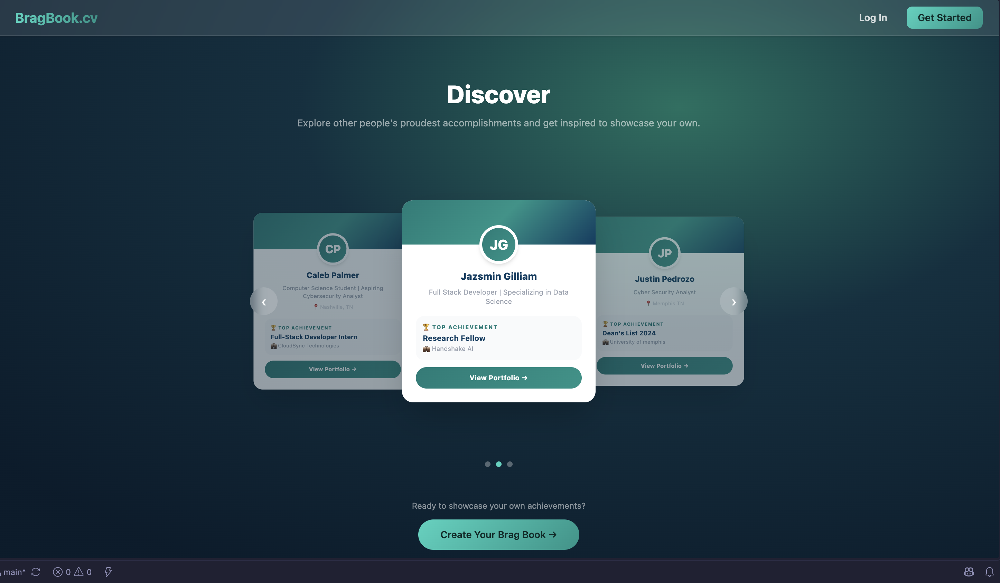
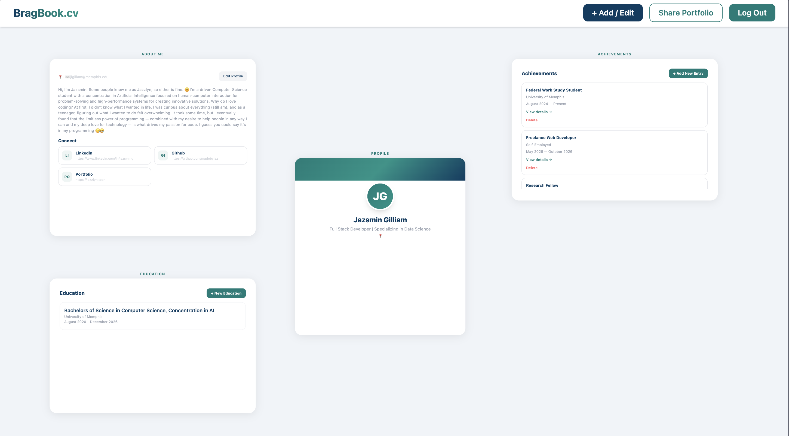
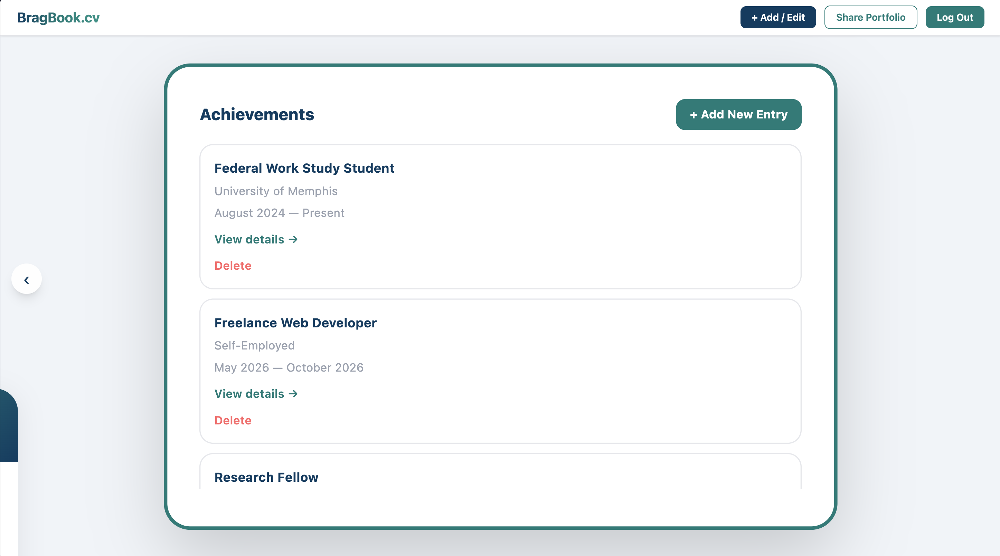
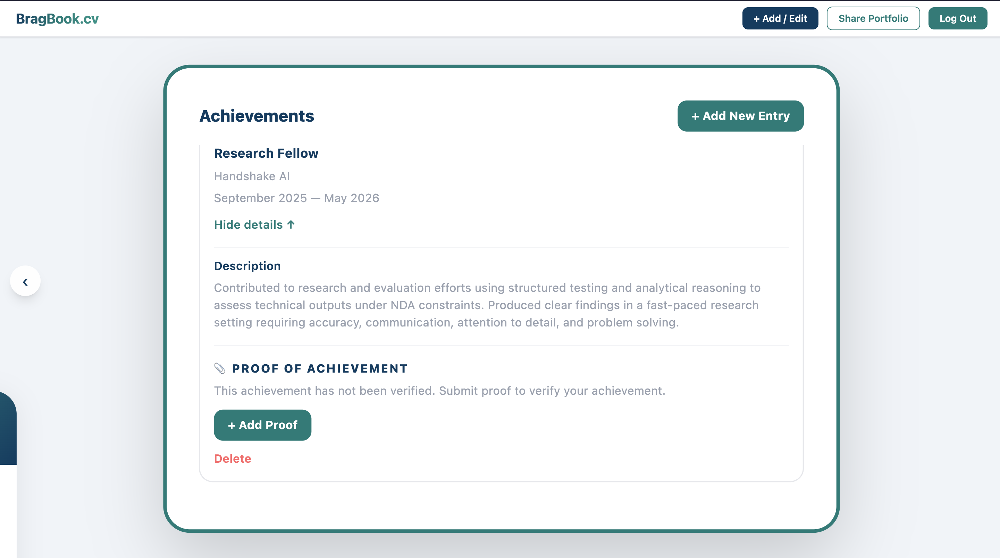
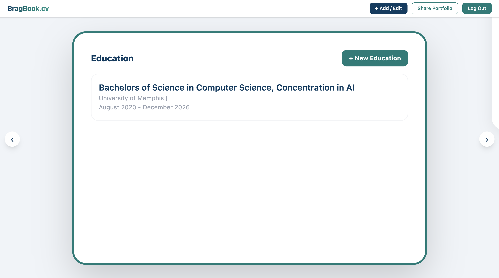
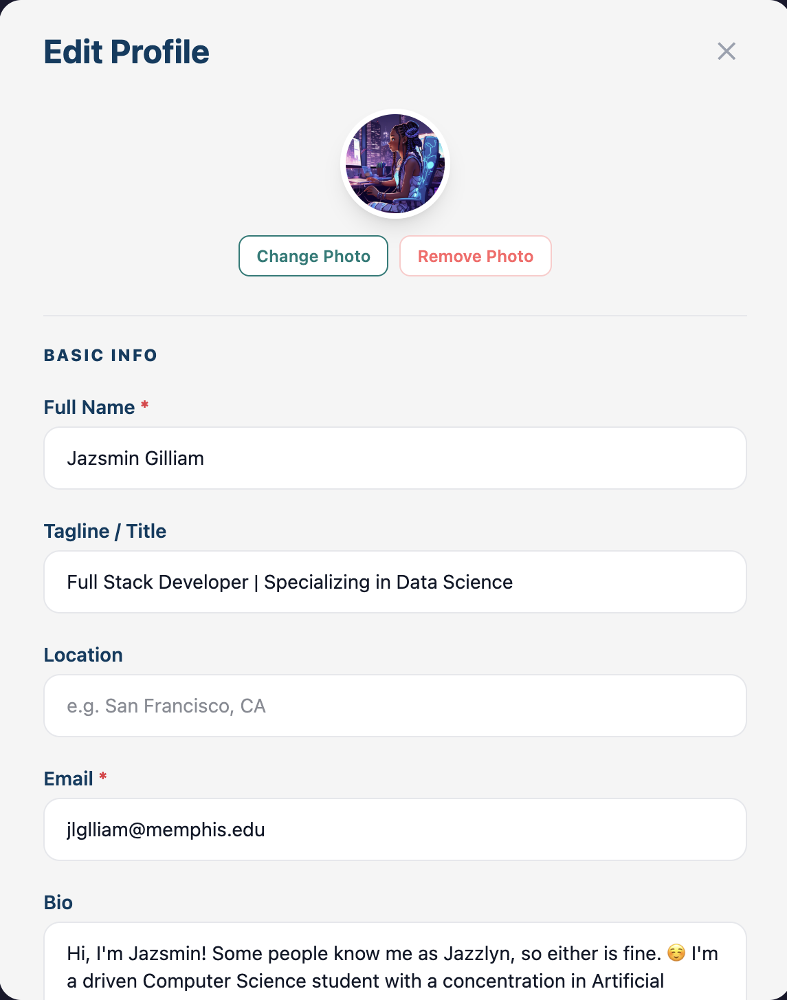
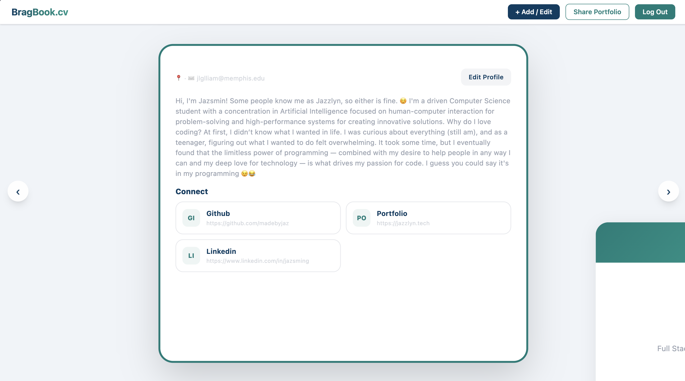
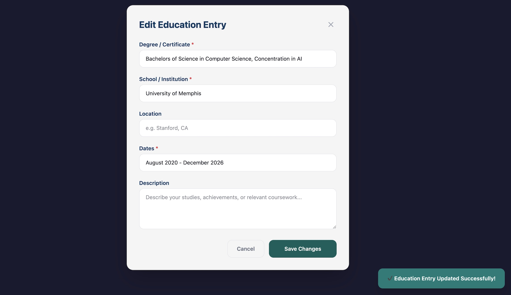

# <em>**BragBook.cv** — The Verifiable Portfolio</em>

## What is BragBook?
BragBook.cv is a web-based portfolio platform that helps professionals document their achievements, completed projects, and career milestones. Users organize their work into brag entries and build a professional profile to support interviews, performance reviews, and career development conversations.

Proof attachments let users provide supporting evidence alongside their achievements, giving their portfolio more context and credibility.

> **Please Note:** This repository is a fork of the official BragBook.cv project from my institution’s private repository.

## MVP Features

The current implementation includes:

### Professional Profiles

- User profiles with a name displayed in the profile header.
- An edit profile form for updating profile information.
- Profile photo and avatar uploads.
- An education section with forms to add, edit, and delete education records.

| Discover Overview | Profile Overview |
| --- | --- |
|  |  |


### Achievement Entries

- A create entry form for documenting achievements and projects.
- Entry cards displayed on the profile page.
- An update entry form for editing existing entries.
- Proof attachments for supporting achievement entries.

| Achievement Entry Overview | Achievemen Entry Overview 2 |
| --- | --- |
|  |  |


### Portfolio Experience

- Story chapter card previews.
- A close button for the user portfolio frame zoom view.
- A connections spider web component for visualizing connections.

| Education Overview | Education Details |
| --- | --- |
|  |  |

| About Overview | Saving a Form | Edit Profile Form |
| --- | --- | --- |
|  |  |  | 


> **MVP Goals:** The overall MVP aims to connect account authentication, database-backed entry management, and a shareable public portfolio into a complete user journey.

## Planned Improvements

- Sort entries by date.
- Add a confirmation dialog before deleting an entry.

## Design and Development

Completed design work includes low- and high-fidelity wireframes, user flow diagrams, a homepage transition state map, and a revised Figma prototype for the homepage transition flow. These artifacts guided the profile, entry management, and portfolio interfaces.

## Peer Reviews

Classmate feedback helped guide improvements to the MVP’s
design, usability, and functionality.

- [Peer Review 1](docs/formal_reviews/Jazsmin-Gilliam_Feedback_Recieved.pdf)
- [Peer Review 2](docs/formal_reviews/Jazsmin_Gilliam_feedback_recieved.pdf)

## Getting Started

### Prerequisites

- Node.js and npm.
- A local copy of this repository.

### Installation

- From the project directory, install dependencies:

```bash
npm install
```

### Run Locally
- Start the development server:

```bash
npm run dev
```
Open the local URL printed in your terminal.
